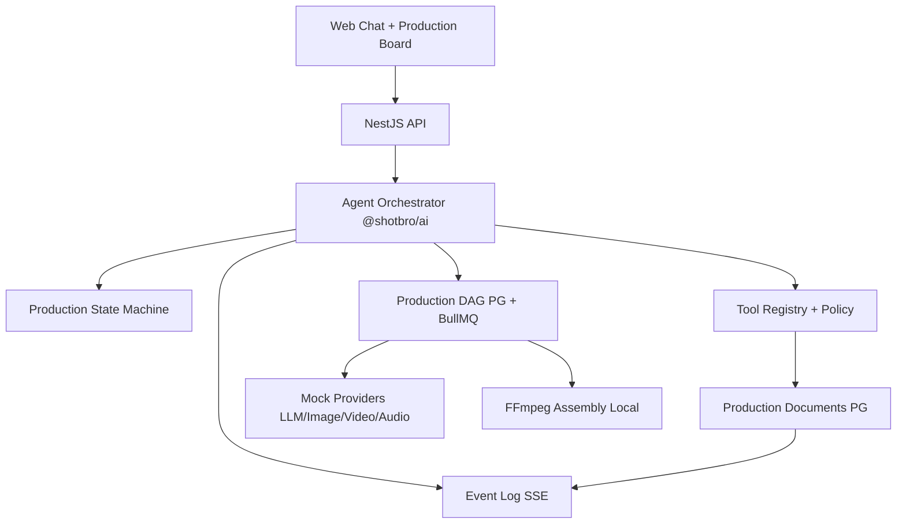

# Phase 3 — Target architecture

Baseline: Phase 2 RC (`e5c4045…`). All AI execution in Phase 3 uses **mock providers** until owner enables live mode separately.

---

## 1. Layered flow



**Rule:** Frontend never calls generative provider APIs. LLM tool calls are validated server-side; only registered tools run.

---

## 2. Packages

| Package | Responsibility |
|---------|----------------|
| `@shotbro/contracts` | Zod: production entities, agent API DTOs, REAL message blocks with `mock` marker |
| `@shotbro/db` | Drizzle schema + migrations for documents, graph, memory, agent state |
| `@shotbro/config` | Env: `AI_MOCK_MODE`, `PROVIDER_LIVE_EXECUTION_ENABLED`, OpenRouter guards |
| `@shotbro/ai` | Orchestrator, planners (deterministic mock reasoning in Phase 3), state machine, tool registry, providers, cost |
| `apps/api` | REST v1, ApprovalService integration, agent module, graph enqueue |
| `apps/worker` | DAG step workers, FFmpeg compose, mock provider polling |
| `apps/web` | Existing cards + production board panel |

---

## 3. Agent state machine

States (TZ §6): `DRAFT` → `BRIEFING` → `PLANNING` → `WAITING_PLAN_APPROVAL` → … → `COMPLETED`, plus `PAUSED`, `FAILED`, `CANCELLED`, `NEEDS_REVISION`, `BLOCKED_PROVIDER`, `BLOCKED_BUDGET`.

- Persisted on `agent_run.production_state` (enum) + metadata JSON  
- Transitions validated in `@shotbro/ai/state-machine.ts`  
- `PRODUCING` requires cost + production approvals  
- Script/plan version bump invalidates dependent approvals (server rule)

---

## 4. Structured documents

Stored in `production_document` (type, version, status, schema_version, payload JSONB, project_id, created_by).

Typed payloads in `@shotbro/contracts/production/*`:

- ProductionBrief, CreativeConcept, ProductionPlan, Script (+ scenes), Storyboard (+ frames), ModelSelection, CostEstimate, Timeline, DeliveryPackage

Messages reference document IDs in block payloads; **source of truth is PG**, not chat text.

---

## 5. Production graph (DAG)

Table `production_graph_node`:

- node type, dependencies[], status, input refs, output asset IDs, provider, costs, version hash, approval flags

Execution:

- BullMQ jobs per node; FlowProducer for dependencies when enabled  
- Idempotency keys per node + version hash  
- Selective regen: only stale nodes re-queued  

Phase 3: mock nodes return fixture assets marked `mock: true`.

---

## 6. Tool registry

Each tool: name, JSON schema (Zod), permission policy, cost class, side-effect class, timeout, idempotency.

Side-effect classes:

- `READ_ONLY`, `DATABASE_WRITE`, `LOCAL_MEDIA_PROCESSING`, `EXTERNAL_FREE`, `EXTERNAL_PAID`

**`EXTERNAL_PAID` blocked** when `PROVIDER_LIVE_EXECUTION_ENABLED=false` or `AI_MOCK_MODE=true` — **before any network I/O**.

---

## 7. Provider adapters

Interfaces in `@shotbro/ai/providers`:

- LLM (mock + OpenRouter scaffold)
- Image / Video / Audio generation (mock job lifecycle Phase 3)
- Media processing (FFmpeg local)
- ElevenLabs adapter stub (no live TTS in Phase 3)

Model capabilities only from registry config — no invented features.

---

## 8. Cost engine

Tables (Phase 3 increment):

- Estimates on documents / graph nodes  
- `project.settings.budget` + future `budget_reservation` table  

Three gates: global owner limit, project budget, per-operation approval.

Phase 3 validates with mock cost events and unit tests.

---

## 9. API (v1)

Namespace under `/api/v1/projects/:projectId/…`:

- Agent runs CRUD + pause/resume/cancel  
- Brief, scripts, storyboards, production-plan, production-graph (read/write per TZ)  
- `/api/v1/ai/models|providers|tools|cost/estimate` — extend existing `ai` module  

Auth: session guard + project access policy (existing).

---

## 10. Events (SSE)

Extend EventLog types:

`agent.run.*`, `agent.tool.*`, `production.*`, `approval.*`, `cost.*`, `delivery.ready`

State remains in PostgreSQL; SSE for UX only.

---

## 11. Execution flags (mandatory Phase 3)

```
OPENROUTER_ENABLED=false
OPENROUTER_ALLOW_PAID_REQUESTS=false
PROVIDER_LIVE_EXECUTION_ENABLED=false
AI_MOCK_MODE=true
```

Server-side assertion in `@shotbro/config/ai-execution.ts` used by all paid-capable adapters and tool executor.

---

## 12. Implementation stages

See `PHASE3-PROGRESS.md` — Stages A–J aligned with TZ §23.
