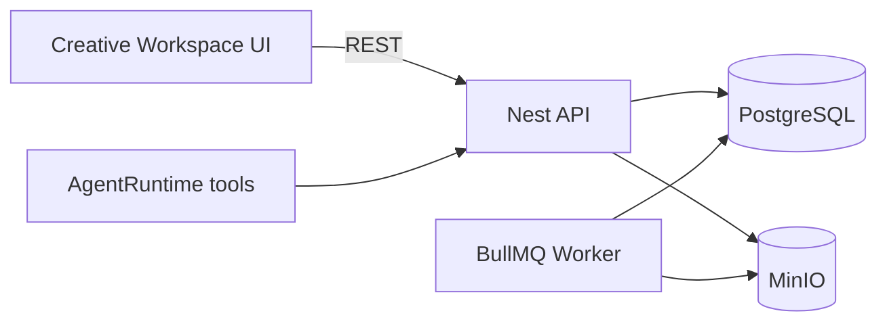

# Phase 5 — Architecture

## Principle

One studio, one project context, two synchronized views:

- **AI Chat** — orchestration, approvals, delivery (unchanged flow).  
- **Creative Workspace** — structured editing of persisted documents and memory.

Both read/write the same PostgreSQL state via API. No parallel demo-only script store for REAL mode.

## Layout (desktop)

```
StudioShell
├── StudioSidebar (projects)
├── Column main
│   ├── StudioHeader
│   ├── AgentRunStrip (REAL)
│   ├── CreativeSectionNav   ← Phase 5B
│   └── Section body
│       ├── chat → RealThread
│       ├── script → ScriptEditor (5C)
│       ├── storyboard → StoryboardStudio (5D)
│       └── …
└── RealContextPanel (context / graph / assets / models)
```

Mobile: horizontal section nav + existing sheets for context panel.

## Data flow



## Document ownership

| UI section | Primary store |
|------------|----------------|
| Brief | `production_document` BRIEF |
| Script | `production_document` SCRIPT (version chain) |
| Storyboard | `production_document` STORYBOARD |
| Prompts (5G) | `prompt_version` + Creative **Prompts** tab (`PromptStudio`) |
| Characters | `project_memory.characters` |
| References | assets + memory links (5F) |
| Timeline | `production_document` TIMELINE (5I) |
| Assets | `assets` + MinIO |

## Approval & invalidation (5L)

Edits call existing graph invalidation hooks on scene/character/prompt changes. Production approval remains bound to payload hash; material changes require re-approval.

## Agent tools (5K + 5G)

Phase 5G adds prompt CRUD delegates mirroring HTTP: `get_scene_prompt`, `save_scene_prompt`, `list_prompt_versions`, `compare_prompt_versions`, `restore_prompt_version`, `get_scene_model_settings`, `validate_prompt_for_model`, `prepare_scene_prompt`. Handlers registered in `phase5-prompt-tools.ts`; catalog entries in `phase4-tool-catalog.ts`.

Extend ToolExecutor handlers to call the same services as HTTP controllers (no SQL from LLM). ContextBuilder loads active document versions after UI saves (prompt bundle parity — 5K follow-up).
