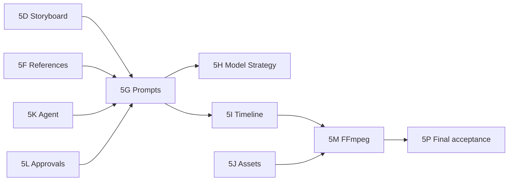

# Phase 5 — Remaining work (roadmap correction)

**Updated:** 2026-10-25 after original-TZ audit + **5G implementation in branch** (VPS acceptance pending).

## Priority legend

- **P0** — unfinished core production chain (prompt → generate → timeline → deliver).  
- **P1** — settings, versions, approvals, UX cohesion.  
- **P2** — convenience, Magnific polish, documentation imports.

## Stage map (avoid duplicate work)

| Stage | Status (branch) | Depends on | Do not redo |
|-------|-----------------|------------|-------------|
| **5G Prompt Studio** | **IMPLEMENTED** (await VPS E2E) | 5D–5F | — |
| **5H Model Strategy** | Partial (Providers tab, route-plan) | 5G prompts | Multi-provider mock extension (5MP) |
| **5I Timeline** | NOT STARTED | 5G, 5D scene order | — |
| **5J Asset Library** | Partial (upload/picker) | assets API | MinIO pipeline |
| **5K Agent Integration** | Partial (delegates; +prompt tools in 5G) | 5G | ToolExecutor pattern |
| **5L Approval Dependencies** | Partial (hash invalidation) | all editors | ApprovalsService core |
| **5M FFmpeg Assembly** | Partial (worker mock) | 5I timeline JSON | compose_video tool |
| **5N UX** | Ongoing | 5G–5M | Creative shell (5B) |
| **5O Testing** | Ongoing | each stage | strict 8/8 baseline |
| **5P Final Acceptance** | NOT STARTED | 5I–5M | Phase 3/4 sign-off |

## P0 backlog

1. **5G VPS acceptance** — deploy web+api, `phase5-prompts`, regression suites; fill `PHASE5-PROMPT-STUDIO-ACCEPTANCE.md`.  
2. **5I Timeline editor** — versioned `TIMELINE` document, scene order + clip lengths, worker reads same JSON.  
3. **5M FFmpeg** — bind assembly to timeline + selected asset versions (not script order only).  
4. **Production workspace tab (5H/Production)** — surface graph status currently in context panel only.  
5. **Live generation policy** — remains **off** until separate cutover; mock jobs stay default.

## P1 backlog

- Unify **Model settings** ↔ **Prompt Studio** (shared scene + model snapshot).  
- **Approval UX** for prompt_version and storyboard revisions.  
- **Scene result gallery** (provider job outputs per scene).  
- **Asset Library** tab (5J) beyond context list.  
- **Agent context** (5K): ContextBuilder loads latest prompt bundle after UI save.

## P2 backlog

- Magnific upscale UI + job type.  
- Import **original TZ** into `docs/` (resolve SOURCE_MISSING).  
- SSE live updates in workspace tabs.

## Dependencies graph (simplified)

## Explicit non-goals (this sprint)

- New infra stage / second prompt store.  
- Live paid AI (`PROVIDER_LIVE_EXECUTION_ENABLED=false`).  
- Docker image hoarding or co-tenant cleanup.
